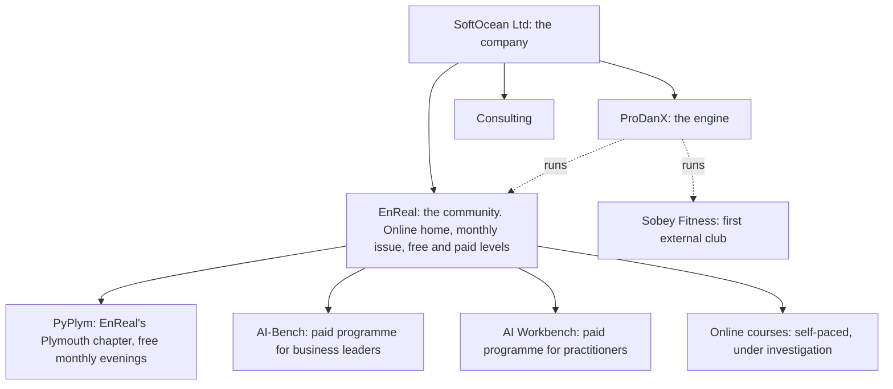

# EnReal: vision foundation

**Draft 0.2 · 17 October 2026 · internal** (structure crystallised in the grilling on 17 October; see §2.1). The single source of truth for every EnReal deck: why it exists, what it stands for, what each part is called, who it serves, what can truthfully be said, and how the parts fit. Decks draw their language from here.

---

## 1. Why EnReal exists

AI is now part of how people learn, work, decide and run organisations. The evidence shows it can **help or harm** depending on how it is used. In a 2025 field experiment with nearly a thousand high-school maths students, those who practised with unrestricted ChatGPT did better while they had it, then scored **17% lower** in the exam than students who never had it. A version designed to give hints rather than answers largely removed that harm ([Bastani et al., PNAS 2025](https://ideas.repec.org/a/nas/journl/v122y2025pe2422633122.html)).

What people need is not more tool demonstrations or more hype. They need to understand **how they themselves learn, decide and work**, and **how the technology actually behaves**, and then build something real with both in mind.

temp 

> **EnReal helps people use AI as a tool for human purposes: understood from the human side, built with technical honesty.**

## 2. Positioning

### SoftOcean (the company), decided 16 October

> **SoftOcean builds high-technology software and gives hands-on consulting, without forgetting the human.**

SoftOcean is a small consultancy and software business. Its aim is to **build software and automation, and to consult**, not to run communities or conferences. Its strengths: **understanding people and their requirements, planned delivery, and software** across science, data, machine learning and AI. Its portfolio, in order of evidence:

| Work | What it shows |
| --- | --- |
| **PlanktoSpace** for Plymouth Marine Laboratory (delivered, live) | Turning a scientific need into a field app people use daily |
| Electromagnetic instruments and subsea-cable signal analysis | Physics and measurement turned into practical tools |
| Machine learning and data systems (including Met Office work) | Data turned into decisions |
| **ProDanX** (built; proof of concept) | A multi-brand community platform, engineered and audited |
| **EnReal and PyPlym** (from January 2027) | Where SoftOcean practises the human side of AI in public, and shows ProDanX working |

**EnReal is a SoftOcean initiative, not SoftOcean's identity.** Events are the lab and the channel; the business is software, automation and consulting.

### 2.1 The structure in one picture (settled 17 October)

| Part | What it is | Its analogy in ProDanX's first Brand |
| --- | --- | --- |
| **EnReal** | **The community.** Its home is online, with content at several access levels (public, free, paid) and a **monthly issue** | The Jujitsu Movement: the movement every club belongs to |
| **PyPlym** | **EnReal's Plymouth chapter:** free monthly evenings, each taking the topic EnReal ran online the month before (D-56) | One club in the movement, such as DanJJM |
| **Programmes:** AI-Bench, AI Workbench, and later their online editions and company pods | **Paid offerings in EnReal,** open to people from the chapter and from online | A movement-wide workshop that any club's members can book |
| **Online courses** (under investigation, D-68) | **Self-paced EnReal offers, fully online:** made once, kept up to date, bought for one result, and running without the founder's time beyond updates. Investigated alongside the monthly issue ([13](13-online-track.md)) | The movement's home-study syllabus, open to anyone |
| **ProDanX** | **The engine** they all run on: one login, a separate membership in each part | The platform the movement and its clubs run on |
| **SoftOcean** | **The company** that builds the engine and runs EnReal; its business is software and consulting | — |

**Say it like this:**
- **In 10 seconds:** "EnReal is a community for using AI well, from the human side and the technical side. It meets online every month, and in Plymouth as PyPlym from January. Issue #1 is running now: scan to join, it's free."
- **The structure:** "EnReal is the community. PyPlym is its Plymouth chapter. AI-Bench and AI Workbench are its paid programmes. They all run on ProDanX, the platform SoftOcean built."
- **To a sponsor:** "One sponsorship reaches two audiences: practitioners in the room in Plymouth at PyPlym, and EnReal's members online. One report covers both."

**Keeping it bulletproof:**

| Claim | Must be true when it is said | Do not say until then |
| --- | --- | --- |
| "Issue #1 is running now" | The issue is published and sign-up works (target 20 November) | "Running", if it slips: say "starts on [date]" |
| "Scan to join, it's free" | The free membership level exists, with a working QR destination | — |
| "Two audiences" | Quote the **actual** numbers of each: **distinct people, the known overlap, attendance, and issues delivered.** Define the inventory (which event, which issue, for how long, and what report follows) before promising it | "Global audience", until members from outside the UK exist; "a large community"; the sum of both lists as unique reach |
| "Online every month" | Issue #2 is scheduled | — |
| "Runs on ProDanX" | EnReal members are actually using it | Before 20 November: "is being prepared on" |

**Later possibility, not a plan:** other chapters run by local organisers in other cities, on the same engine, as the Jujitsu Movement has several clubs. That would grow EnReal without founder hours.

### EnReal (the community and learning initiative)

| | |
| --- | --- |
| **What we are** | A community for practical AI, online every month, with its first local chapter in Plymouth (PyPlym); run by SoftOcean |
| **For whom** | Anyone who wants to use AI well: developers, and equally people who are not technical |
| **What makes us different** | Every topic is approached from **both sides**: the human mechanism (how we learn, delegate, remember, judge) and the machine mechanism (how AI does it, and where it fails), then a practical session where a developer and a non-technical person build something together |
| **What we are not** | A tool showcase, a vendor event, a hype stage, or a sales room |
| **Tagline candidates** | "AI from the human side, built properly." · "Human first. Technically honest." · "Understand yourself. Understand the machine. Build." |

## 3. Brand architecture and names

| Name | Use it for | Never call it |
| --- | --- | --- |
| **SoftOcean** | The company: high-technology software and hands-on consulting, without forgetting the human | "the platform"; "a community company"; "a leader in community software" |
| **EnReal** | **The community** ("Engineering Reality"): online home, monthly issue, free and paid levels | a meetup; a course; a layer above the real things |
| **PyPlym AI Edition** | **EnReal's Plymouth chapter:** free monthly evenings | a course, a business, a separate organisation |
| **AI-Bench** | An EnReal **programme:** the paid peer group for business leaders | advanced PyPlym |
| **AI Workbench** | An EnReal **programme:** the paid hands-on programme for practitioners | AI-Bench |
| **Issue** | One month of EnReal: one topic, two notes, a live session, a try-this, an optional challenge | a lesson, a module |
| **Online course** | A self-paced EnReal offer: made once, kept up to date, bought for one result (under investigation, D-68) | an issue; a programme; a cohort |
| **ProDanX** | SoftOcean's platform for community, booking and membership apps (internal and technical audiences) | shown by that name to club members (customers see their own brand) |

## 4. Audiences

| Audience | What they care about | Document |
| --- | --- | --- |
| Community organisers (Digital Plymouth) | A healthy local tech scene; good events for their members | 01 |
| Venues and civic bodies (Real Ideas, the Council) | Skills, inclusion, use of their spaces, local economy | 01, 02 |
| Employers and sponsors (Babcock, Helsing, local firms) | Talent, skills, local reputation | 01, 02 |
| Advisory partners (Monument AI) | Access to leaders and practitioners; credibility; joint work | 01, 02 |
| Business leaders | Making one real AI change that works | 03 |
| Practitioners | Building applied and agentic AI properly | 04 |
| The team (Kamila, Cecy) | What they do, how it fits, why it matters | 05 |
| Prospective customers and members | Evidence SoftOcean builds good community software | 06 |
| Sobey Fitness | Less admin, a stronger community | 07 |

## 5. Principles

1. **Human first, technically honest.** Every topic from both sides.
2. **Practical.** People leave having built or tried something.
3. **Inclusive.** Developers and non-technical people learn together; practical sessions pair them.
4. **No pitching.** Partners and sponsors speak about practice, not products.
5. **Open.** Materials are published after each session.
6. **Evidence over opinion.** Claims cite sources; uncertainty is stated.

## 6. The team

| Person | Role |
| --- | --- |
| **Tomasz Szyrowski** | Founder and lead: technical content, teaching, facilitation, engineering. Principal AI Engineer; PhD (University of Plymouth) in estimation from noisy measurements; seven years' study of psychology; Met Office data-sensing and visualisation work; built PlanktoSpace for Plymouth Marine Laboratory; founded the original PyPlym |
| **Cecy** | **Research and design lead**: identity, decks and visuals, and the **"human side" block** at events, presenting what the research on learning and work behaviour says, with sources; content reviewed by the founder |
| **Kamila** | Operations: venues, scheduling, registration, administration; owns the Sobey Fitness relationship |

## 7. What we can truthfully say today (proof points)

| Claim | Status |
| --- | --- |
| SoftOcean built **PlanktoSpace** for Plymouth Marine Laboratory; it is live on Android and iOS and used by researchers | True (delivered) |
| SoftOcean built **ProDanX**, a multi-brand community, booking and membership platform; an independent audit found no critical security issues and real tenant isolation | True (proof of concept; pre-launch security work remains before real members) |
| The founder **founded and ran PyPlym**, which produced professional connections and job offers | True (historical) |
| A PyPlym participant went **from taxi driver to developer and is now a tech lead**; the story reached Monument AI independently | True per the founder; **use only with that person's permission**, ideally in their own words |
| The founder is a **Principal AI Engineer** delivering enterprise AI systems | True (client unnamed) |
| PyPlym AI Edition **relaunches in January 2027** | Planned |
| AI-Bench and AI Workbench | Planned; not yet running |
| Kaggle Gemma 4 work | A paper is planned for 12 November 2026; nothing published yet |

## 8. Language rules

- **Planned things in the future tense.** "PyPlym will run on ProDanX", not "runs on".
- **No absolute market claims** ("nowhere else", "the only"). State our specific difference instead.
- **No "leader" or "premier" claims** without evidence.
- **Partners named only with permission.**
- **Referrals are optional, disclosed and based on fit.** Participant details are never shared as sales leads.
- **Psychology content is research-informed, not clinical advice.** Sources are shown on the slide.

## 9. Boundaries with the founder's contract (internal)

The founder contracts through an umbrella company and an agency to IBM, for an end client. As he describes the agency contract, it prevents him working for IBM directly without the agency, and offering services to the end client without IBM.

| Activity | Position |
| --- | --- |
| PyPlym (a community group) | Outside the contract's scope, in the founder's view; run outside contracted hours |
| Sponsorship requests to any local organisation for PyPlym | A request for community support, not an offer of services |
| SoftOcean's **commercial** offers (AI-Bench seats, AI Workbench, consulting, ProDanX) | **Never offered to the end client directly**; only through the contracting chain |
| Content at events | Public and generic only; nothing from IBM's or the client's systems, data or documents |
| Days off for SoftOcean work (for example a consulting day) | Arranged with the agency **in advance**, as days not worked, under the assignment's own terms. Working through an umbrella company makes the founder its employee, so the exact rules (notice, approval, holiday) come from the umbrella and assignment contracts, not from general contractor practice; check them once and record the answer here |
| Evidence | Hours logged, showing venture work happens outside contracted time |

If asked, the honest framing is the strongest: PyPlym is a community the founder runs because teaching keeps his skills sharp; SoftOcean is his company, operating outside contracted hours, with no client material and no solicitation of the client.

## 10. Roadmap (honest)

| When | What |
| --- | --- |
| October–December 2026 | Partners, venue and first season content; ProDanX prepared for PyPlym and the online offer (running by 20 November); **online Issue #1** (challenge 30 November – 13 December); **Digital Plymouth Christmas Social, 3 December**; Sobey approach; Kaggle paper (due 12 November) |
| January 2027 | PyPlym AI Edition, first event |
| January–March 2027 | Monthly events; AI-Bench discovery conversations; AI Workbench design |
| Spring 2027 | First paid programmes if demand is shown |
| 2027 (date open) | **The first online course built** (under investigation, D-68); its buyer, checks, packaging and price set from what the build shows ([13](13-online-track.md) §7) |
| Mid 2027 | Review of the first season of six events |

## 11. Plymouth context (verified October 2026)

| Fact | Source |
| --- | --- |
| £50m Plymouth Defence Growth Deal (April 2026): expands the National Centre for Marine Autonomy; a Marine Autonomy Trials Authority; a skills hub with ~60 courses | [PML](https://pml.ac.uk/News_and_media/News?page=50), [North Devon Gazette](https://www.northdevongazette.co.uk/news/around-devon/ps50m-defence-boost-announced-for-plymouth-to-create-jobs-and-investment-6585875) |
| Helsing opened an 18,000 sq ft maritime "Resilience Factory" near Plymouth (November 2025), its Maritime Centre of Excellence, starting with ~50 roles and expecting hundreds | [UK Defence Journal](https://ukdefencejournal.org.uk/helsing-opens-uk-site-for-ai-sub-hunter-drone-production/), [Navy Leaders](https://navyleaders.com/news/new-helsing-factory-is-firms-maritime-centre-of-excellence/) |
| Babcock's Devonport STEM team reports 147 events reaching 13,649 students in a year; Babcock sponsors digital and STEM spaces at the Brickfields Hub | [DRDL Social Impact Report 2026](https://www.babcockinternational.com/wp-content/uploads/2026/05/DRDL-Social-Impact-Report.pdf), [Plymouth Argyle](https://www.pafc.co.uk/brickfields-partners/babcock-international) |
| Real Ideas runs **Market Hall** in Devonport, "a vibrant hub for immersive experiences, learning, co-working and community", aimed at opening digital opportunity in one of the city's most deprived areas | [Real Ideas](https://www.realideas.org/), [University of Plymouth alumni](https://www.plymouth.ac.uk/alumni/invenite/back-to-the-future) |
| Local AI learning already exists: Digital Plymouth (quarterly meetups), LifeIn AI (annual festival), Anapoly AI Labs, City College Plymouth's AI Essentials course | [Digital Plymouth](https://meetup.com/digital-plymouth), [LifeIn AI](https://www.realideas.org/events/lifein-ai-2026-plymouths-ai-festival), [Anapoly](https://www.anapoly.co.uk/), [City College](https://www.cityplym.ac.uk/courses/business-improvement-ai-essentials/) |

## 12. SoftOcean's website today

softocean.net presents SoftOcean as an IT consultancy "built on strong family values", with "no corporate red tape", and **PlanktoSpace** as its flagship project, alongside a portable electromagnetic-induction instrument, cable-integrity signal analysis and geophysical surveying. **ProDanX and EnReal join as another case study in the portfolio, not a new identity** (document 06): positioned now as "we build software for communities, and run our own community on it", and later, once Sobey and EnReal have results, as a proven community builder. PlanktoSpace stays the flagship until the new work has comparable evidence. The website's current "premier" wording should be reviewed against the language rules (founder's choice).

**Business cards (16 October):** the SoftOcean card's tagline, *"Where human potential meets AI capability"*, already matches this positioning; its services row and email need updating. Review: [../brand-assets/2026-10-16-business-cards-review.md](../../content/brand/2026-10-16-business-cards-review.md).

