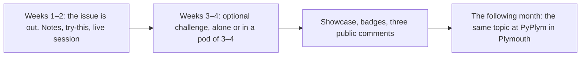

# EnReal online: the monthly issue

**Investigation · version 0.4 · 17 October 2026 · for Tomasz** (sections 1, 4, 5 and 9 are also for Kamila and Cecy; the plain-language version is in [document 05](05-prodanx-enreal-inside.md)). Terms are in [CONTEXT.md](../../CONTEXT.md). Dates live in [PLAN.md](../../work/plan.md) §5.

Labels:
- **[V]** verified;
- **[K]** known but unchecked;
- **[A]** assumption or estimate;
- **[F]** founder statement.

**What changed in version 0.4,** after the 17 October review (review 2026-10-17-online-offer, deleted; in git history):
- **a concrete public, free and paid comparison** (§5);
- **the topic rhythm:** online first, then PyPlym the following month (§4);
- **a pilot that counts the right things:** who could see it, who saw the offer, who joined and when, who paid (§9);
- **a route for late joiners** from the 3 December social;
- **one observed pair session;**
- Stripe Billing fees added to the price table;
- the edges are **observed, not concluded**.

Earlier versions: version 0.3 made building optional and introduced the monthly issue; version 0.2 treated the edge as a hypothesis, moved online first and stopped anchoring the price.

---

## 1. In plain words

**EnReal** is the community. Every month it publishes an **issue** on one topic. An issue contains:
- a short **research note** from Cecy (what studies say about how people learn, decide or work);
- a **lab note** from Tomasz (what he built or tested);
- a 30-minute **"try this"**;
- a **live online session**;
- an **optional challenge**, done alone or in a small group (a "pod").

**Free members** get the public parts, the try-this and the challenge. **Paid members** also get the full notes, the live session and its recording, and the library of past issues.

**The first issue is free for everyone,** so people can judge it. In mid-December we invite them to pay for the second.

**The goal of this experiment:** find out, at a known cost, **whether people who have seen a real issue will pay for the next one,** and which part they value. It is the first step towards the £3,000 a month in [PLAN §0](../../work/plan.md).

## 2. Why online first

Online is **cheaper to get wrong and easier to retry** than a first impression with Plymouth's partners, because the commitment is small, the claims are truthful, and there is a fallback. The medium itself does not make it reversible: public promises online still cost something if broken.

**The pilot also:**
- rehearses the format;
- tests topic 1's content before PyPlym uses it in January;
- gives ProDanX real users first.

**Two cautions:**
1. **Features cost evening hours.**
2. **Lessons about format and platform carry over to local; demand does not.**

## 3. What a member pays for

| | Value | Who creates it | Monthly cost to Tomasz |
| --- | --- | --- | --- |
| **Sense-making** | The topic made clear: what is real, what research says, what to try | Cecy and Tomasz | Mostly the topic prepared anyway |
| **Access** | A live session with Q&A, and the recording | Tomasz, with Cecy | 1–2 hours live |
| **Watching people build** | The showcase of optional challenges, with Tomasz's public comments on three | The few who build (the 90-9-1 pattern) [K] | ~1–2 hours |
| **Belonging** | People like them, local and online; badges (they already exist in the platform) [V] | Grows from the three above | Moderation, mostly Kamila |

**It is not a paid chat room:** the value is curation plus access. A close comparator exists: Every charges $30 a month for AI writing, guides and live workshops alongside free content [V, cited in the review]. So this combination is an **established category, not an empty market**. The advantage has to come from **who** is doing it (Tomasz's engineering judgement, Cecy's careful reading of research) and from a small community where a member's real question gets answered.

## 4. How a month works, and how topics flow

- **Topic rhythm (D-56): each topic runs online first, then at PyPlym the following month.** Issue #1 (learning) is November–December; PyPlym takes learning in January. Issue #2 (delegation) is January; PyPlym takes it in February.
- **Monthly from January.** The full calendar is in [PLAN §5](../../work/plan.md).
- **Pods:** 3–4 people, matched **by hand** (Kamila) for the first three issues.
- **Messaging within pods** at first. The code stays ready to widen it later [F].
- **Public content** sits outside every offer community and brings people in.

## 5. Public, free and paid: the concrete comparison (starting hypothesis)

*Founder: "I need to start from something." This is that something, trialled with the Issue #2 invitation.*

| | **Public** (anyone, no account) | **Free member** | **Paid member** |
| --- | --- | --- | --- |
| Research note and lab note | **The first part of each:** the key idea, why it matters, one example (about 500 words) | The same, plus discussion in the feed | **The full notes:** the worked build, the code, the sources and their limits, the exercise solution |
| Try-this (30 minutes) | Yes | Yes | Yes |
| Challenge, pods, badges | The showcase is visible | Take part | Take part |
| **Live session** (monthly) | — | — | **Yes, with Q&A** |
| Recordings, and the library of past issues | A 2–3-minute highlight clip | — | **Yes** |
| Feedback | Three public comments per issue on showcase builds | The same | The same, **plus questions answered live** |
| Member prices on programmes (and on online courses, if they are sold separately: D-69, a hypothesis) | — | — | Yes |
| **Later** | Nothing beyond the first parts and the highlights becomes public, so paid stays worth having | | |

**Writing cost:** one note each, with a natural break after the first part. No second version to write.

**Issue #1 is the sample: all of it is free to everyone who joins.** The 14 December invitation then shows this table, the price, the Issue #2 date (11 January) and how to cancel.

**Paying changes the level, not the community.** A member who stops paying keeps their pods, posts and badges, and loses only the paid column.

## 6. Candidate edges: what the pilot can show, and what it cannot

| | Possible edge | What we will observe | What that alone cannot establish |
| --- | --- | --- | --- |
| E1 | The human side and building, in one issue | Readers open both notes | That combining them causes payment |
| E2 | Sense-making | People say it saved them time, and come back unprompted | That it beats free alternatives |
| E3 | Live access | Attendance and questions | That access is the reason people pay |
| E4 | The showcase | Builds shared outside the community | That readers will pay to watch |
| E5 | Local and online together | People take part in both | Extra reach beyond the overlap |
| E6 | Recognition | Badge holders return | That badges caused the return |

**The useful step:** at payment, and from those who do not pay, ask one question: **"What made you pay?"** or **"What would have made it worth paying?"** Then choose **one** uncertainty to test properly in a later issue. Do not crown an edge from whichever number looks best.

## 7. Price (research; not decided)

| Reference | Price |
| --- | --- |
| **Every** (AI writing, guides, live workshops) | $30 a month or $288 a year [V, cited in the review] |
| **Focusmate** | Free for 3 sessions a week; Plus about $8 a month billed annually, or $12 monthly [V] |
| **Skool**, 1,000 trending paid communities | Median $27 a month [V, secondary; this sample overstates the typical price] |
| **Maven** live cohorts | $800–2,450 [V, secondary] |

**Paid level to test: £8–12 a month.**

**After Stripe's UK card fee (1.5% + 20p) and Billing (0.7%)** [V]:

| Price | Kept per member | Members for about £2,000 a month |
| ---: | ---: | ---: |
| £8 | £7.62 | 263 |
| £10 | £9.58 | 209 |
| £12 | £11.54 | 174 |
| £20 | £19.36 | 104 |

This is **before** refunds, tools, hosting, everyone's hours and tax. It is not profit, and not household cash.

**Ten payers at £10** keep about £96 a month. That is **excellent first evidence** and nowhere near the goal; both are true. Watch the servicing time as members grow: at an illustrative 5 minutes per member a month, 200 members would need about 17 extra hours.

## 8. The wider ladder

| Later offer | How it would work |
| --- | --- |
| **Online courses** (self-paced, made once and kept up to date) | **Under investigation alongside the issue, not instead of it** (D-68): [document 13](13-online-track.md) |
| **Online editions of AI Workbench and AI-Bench** | Each its own offer community |
| **Company pods** | Private pods for a team, priced per seat. Asynchronous, but still needing some support |
| **Human-versus-machine games** | Using our own passages (kaggle/02), to gather email addresses |
| **Other chapters** | Run by other organisers. They would need onboarding and governance; not free of founder time |

## 9. The pilot: Issue #1

| Field | Content |
| --- | --- |
| **The question** | After a useful first issue, **will people who were shown a clear offer pay for Issue #2, and at what cost in our hours?** |
| **Sequence** | Issue #1 out → live session → challenge fortnight → **Digital Plymouth social** → invitation to pay → Issue #2 out, in that order. **The dates are in [PLAN §5](../../work/plan.md)** (the one calendar) |
| **Route** | The fallback kit (PLAN D1) by default. ProDanX if slices 1–2 are on track at the D1 checkpoint ([PLAN §5](../../work/plan.md)). **The experiment never waits for the build** |
| **Challenge** | Build a personal learning assistant using the Bastani recipe (worked solutions and common mistakes), use it for a week, and note what you can do unaided. **This is pilot feedback, not a replication of the study** |
| **One observed pair session** | During the challenge fortnight: 2–3 builder–explorer pairs, 60 minutes, online, with the explorer driving. Record whether each pair finishes, and how much help it needed. It rehearses PyPlym's format directly |
| **Late joiners** (from the Digital Plymouth social) | The live recording, a 30-minute short version of the challenge, and the same invitation for Issue #2 |
| **Count at each stage** (Kamila keeps the tally) | <ol><li>**Could see it:** followers and contacts per channel, with known overlap.</li><li>**Saw it:** invitations actually sent, page visits, QR scans.</li><li>**Joined:** with the date and **cohort** (before 3 December, or from the social; warm contact, former PyPlym, or stranger).</li><li>**Did:** opened, attended live, tried, built, came back.</li><li>**Shown the paid offer:** price, dates and benefits, with the invitation date.</li><li>**Paid:** paid, refunded, cancelled; later, renewed.</li></ol> |
| **Quiet value** | A return visit, a saved example, someone saying "I changed how I do X". Readers who pay matter as much as builders |
| **Reading the result** | **Report the counts and the circumstances before any label.** Provisional signals: 10 or more payers is a real first signal; fewer than 20 joiners is inconclusive about the offer, but may still reveal a broken route. **Do not read non-payment before someone has been invited as rejection.** The share who build is a diagnostic, not a pass mark |
| **If the showcase is thin** | Use clearly labelled team examples. Never present them as members' work |
| **Caps** | Tomasz ~15 hours (content shared with PyPlym); Cecy ~10; Kamila ~6; cash under £50 |
| **Predictions** | Each person writes their numbers for joined and paid before 20 November |

## 10. Risks

| Risk | Handling |
| --- | --- |
| **Paid access unclear** | The §5 table goes in the invitation |
| **Dead pods** | Pods of four; re-match on day 3; pods are optional |
| **Strangers and safety** | Adults only; a code of conduct; report and block; Kamila moderates; pod-only messaging **enforced on the server** (document 12) |
| **Founder time** | Fixed slots; three public comments per issue; servicing time measured |
| **Payments** | SoftOcean's own Stripe account; by hand first (PLAN D5) |
| **The contract** | No marketing to the end client (document 00 §9) |

## 11. Open decisions

| # | Decision |
| --- | --- |
| 1 | The §5 comparison: the starting hypothesis, reviewed after the invitation |
| 2 | The price to test (£8–12) and the founding price |
| 3 | ~~The online name~~ **EnReal** (D-55) |
| 4 | When to open 16+ |
| 5 | The 3 December slot: ask the organiser |
| 6 | The topic rhythm, online then PyPlym (D-56): **confirm** |
