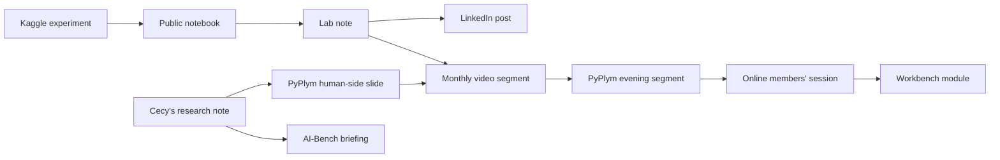

# Content engine: writing, video and Kaggle

**Investigation, with a pilot proposed · 17 October 2026 · for Tomasz, Cecy and Kamila.**

Labels:
- **[V]** verified;
- **[K]** known but unchecked;
- **[A]** assumption or estimate;
- **[F]** founder statement.

Regular written and video content (Tomasz on the technology, Cecy on the human research) is used to build an audience for the online addition ([document 10](10-online-edition-options.md)), whose monthly issue gives every post a next step ("join this month's issue"), and for every other offer.

---

## 1. What the content is for

**Three jobs:**
1. **Build an audience you own:** an email list. Every online offer, including the monthly issue in document 10, needs one.
2. **Show expertise in public:** credibility for consulting and future contracts. Tomasz has seen public Kaggle work help in an interview [F].
3. **Keep Tomasz on the cutting edge:** Kaggle and real experiments force current learning.

**Content is not demand** (process §4). Views and likes show reach, not buyers. **Measure the email list and the replies.**

## 2. Who makes what

| Strand | Who | What | How often | Hours each [A] |
| --- | --- | --- | --- | --- |
| **Lab notes** (technical) | Tomasz | What was built or tested, with code and honest results, failures included. **The first part (about 500 words) is public; the full note goes to paid members** (document 10 §5). Sources: Kaggle, agent evaluation, retrieval, the month's PyPlym build | Every two weeks | 3–4, **on top of work being done anyway** |
| **Research notes** (human) | Cecy | **The first part is public; the full note is for paid members.** One study explained: who was studied, what was done, what was found, the limitation, what to try. This is the "source card" the review proposed; the same card feeds the PyPlym slide | Every two weeks, alternating with the lab notes | Cecy 4–6; Tomasz 0.5 to review |
| **Human × Machine conversation** (video) | Tomasz and Cecy | 15–25 minutes on the month's topic: the research, the build, where they disagree | Monthly, from January | 2 each to prepare and record; 4–6 for Cecy to edit |
| **Shorts** | Cecy | 3–5 clips of 30–60 seconds cut from the conversation | Monthly | 2–3 |
| **Publishing and the list** | Kamila | Schedule, cross-post, send the newsletter and the welcome email, keep the tally of subscribers and replies | Weekly | 1–2 |

**Together, one piece goes out each week:** a lab note one week, a research note the next.

**Tomasz's content lives in the 07:00–08:00 morning hour** ([PLAN.md](../../work/plan.md) §2), together with Kaggle. The lab note is the write-up of the morning's Kaggle or learning work, not a separate task. Evenings stay for ProDanX. A post that needs its own research is outside the budget.

## 3. Where it lives

**Account design update:** the agreed domain and reported Google account are recorded in the [identity inventory](../../operations/enreal-identity.md). The [media design](../../operations/enreal-media-and-account-design.md) recommends an EnReal YouTube channel and brand pages; none is confirmed created. The publishing pilot, series name, people and cadence in this document remain under investigation.

| Role | Channel | Why |
| --- | --- | --- |
| **Home** (owned) | An email newsletter with a web archive; proposed home under EnReal's [chosen identity](../../operations/enreal-identity.md), cross-linked from softocean.net | The list belongs to us; social followers do not. Platform and custom-domain setup remain open; use an existing/free option first |
| Distribution | **LinkedIn** | UK leaders and practitioners; Tomasz's professional network |
| Distribution | **YouTube** | The monthly conversation and the shorts |
| Distribution | **Kaggle** | Public notebooks and discussion posts, read by a technical audience; the profile links home |
| Syndication | dev.to or Medium, with a link back to the original | Extra reach at little cost |

**Byline:** the series is **Human × Machine**, by Tomasz Szyrowski and Cecylia Szyrowska, from SoftOcean. People follow people, so use personal names, with the company behind them.

## 4. Do once, offer many: the reuse chain

**Measure the first three uses of one asset** (review M5):
- the hours to create it;
- the hours to adapt it each time;
- the response each time.

Reuse is a saving only once the measured cost of each reuse falls.

## 5. Video, practically

- **Format:** two people talking, plus a shared screen. No studio.
- **Audio first.** A decent USB microphone matters more than the camera [K].
- **Tools:**
  - a free recorder such as OBS;
  - transcripts and captions from the Whisper pipeline already used for meetings;
  - the transcript is also the first draft of a post.
- **Recording at PyPlym:**
  - speakers only;
  - attendees are told at registration;
  - nobody's work is shown without asking.
- **Start in January,** once the written strand has run for four to six weeks.

## 6. Using AI in production: rules for a human-centred brand

| AI may | People must |
| --- | --- |
| Transcribe, caption, outline, suggest titles, check grammar, find clips | Decide every claim, write the argument, read every source, and publish under their own name |

- **Say so** when AI drafted part of a piece.
- **Never summarise a study without reading it.** The review showed how a summary loses the detail that matters: the Bastani tutor had teacher-written solutions, which changes what the result means.
- **A human-centred brand that publishes AI filler contradicts itself.**

## 7. Kaggle as the technical source

Kaggle supplies the lab notes: the Gemma paper until 12 November, then **Name That LLM** until 13 January ([kaggle/02](../../work/projects/kaggle/02-name-that-llm.md)).

**Name That LLM pairs well with a human question:** *on the same task, how do people and a classifier compare at naming which model wrote a passage?* That gives:
- a lab note (the classifier);
- a research note on what studies of human judgement show **in their own settings**;
- a PyPlym segment for the "judge" topic.

**Keep the claims narrow** (17 October review H10). Naming one of several known models is a **different task** from telling human writing from AI writing. The studies of people (Clark et al., ACL 2021; Jakesch et al., PNAS 2023) support caution only in the settings they tested. Compare people and the classifier on the **same disclosed task and the same held-out passages we generate**, and report the uncertainty.

**Constraint:** the competition data may not be shown to anyone outside the competition [V, rules]. For any public human test, **generate our own passages**.

## 8. The pilot

| Field | Content |
| --- | --- |
| **Decision** | Keep the content engine as the main marketing channel, change its format or channel, or cut it back |
| **Window** | Eight weeks, mid-November (after the Gemma paper) to mid-January |
| **Output** | Eight notes (four lab notes, four research notes); video from January |
| **Measures** | <ul><li>email subscribers (the main measure);</li><li>replies and messages;</li><li>Issue #1 sign-ups and paid members for Issue #2;</li><li>consulting or team-session enquiries;</li><li>hours actually spent per piece;</li><li>views, as a secondary measure.</li></ul> |
| **Thresholds (provisional; reset after the audience count in document 10 §9)** | **Continue:** 100 or more subscribers, and 5 or more real replies or enquiries. **Change format or channel:** fewer than 30 subscribers. **Inconclusive:** in between |
| **Caps** | Tomasz: the morning hour only (about 5 h a week, Kaggle and notes together); Cecy ≤ 5 h; Kamila ≤ 2 h |
| **Predictions** | Each person writes a subscriber number for week 8 before starting |

## 9. Boundaries

- **Public, generic content only.** Nothing from the contract, the client or IBM (document 00 §9).
- **Check the contract's publication and intellectual-property clauses** before the first post (as for the Kaggle paper).
- **Cecy's notes are research-informed, not clinical advice** (document 00 §8).

## 10. Open decisions

| # | Decision | Owner |
| --- | --- | --- |
| 1 | Run the eight-week pilot from mid-November | Tomasz, Cecy |
| 2 | Newsletter platform | Kamila |
| 3 | Series name: **Human × Machine** or another | Tomasz, Cecy |
